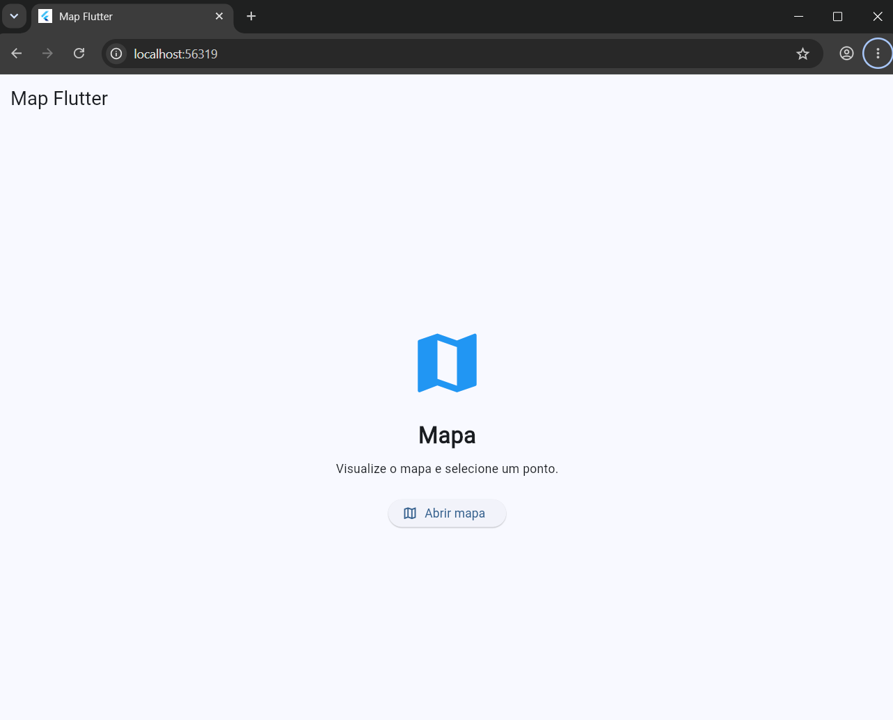

# Flutter Map

Projeto desenvolvido para a Aula 05 - Mapas do curso de Desenvolvimento de Sistemas.

## Sobre o projeto

Aplicativo desenvolvido em Flutter utilizando o Flutter Map e OpenStreetMap.

O aplicativo permite visualizar um mapa e clicar em um ponto para obter sua latitude e longitude.

## Funcionalidades

- Visualização do mapa
- Zoom e movimentação pelo mapa
- Seleção de um ponto
- Exibição da latitude e longitude
- Marcador no ponto selecionado

## Tecnologias utilizadas

- Flutter
- Dart
- Flutter Map
- Latlong2
- OpenStreetMap

## Print do aplicativo

